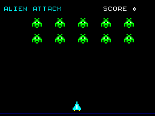

# Randomize USR

Try the current version at [rand.smallhall.net](https://rand.smallhall.net) · [More apps and games](https://smallhall.net)

Randomize USR is a child-friendly, ZX Spectrum-inspired coding storybook. It combines a pixel screen, an editable BASIC-like language, original built-in examples, sound and sprite editors, and optional hosted projects.

The interpreter runs user BASIC in the browser. The API stores project source and snapshots as data; it does not execute user programs.



## What is included

- Guest editing, running, local recovery and portable `.randusr` import/export.
- A 256×192 pixel screen, sprites, animation, keyboard input and bounded cooperative BASIC runtime.
- Sound Lab, SFX and pitched instruments, with Web Audio shared by the editor and BASIC runtime.
- Shipped Examples built into the application.
- Optional registered accounts for private projects, history, sharing and personal assets.
- Optional isolated Demo sessions for evaluation. Demo data is in memory and expires; it is not an account.
- A Fastify API, PostgreSQL 17 persistence and Docker Compose self-hosting path.

Additional in-progress game projects are not part of this source distribution. See the Examples list in the app for shipped content.

## Run locally

Requirements: Node.js 22.12 or newer and npm.

```sh
npm ci
npm run dev
```

Open the Vite address printed by the command. Guest editor, built-in examples, local projects and the runtime work without PostgreSQL or an account. API-backed account features require PostgreSQL and the API; see [development](docs/DEVELOPMENT.md).

## Self-host with Docker Compose

Requirements: Docker Engine with the Compose v2 plugin, Node.js 22.12+ for the one-time setup wizard, a domain name, an HTTPS reverse proxy, and an authenticated SMTP relay.

```sh
git clone <repository-url> randomize-usr
cd randomize-usr
npm run setup
docker compose up --build -d
```

The wizard asks for the instance's HTTPS origin, initial administrator email, SMTP connection and sender. It generates a PostgreSQL password, writes `.env` with mode `0600`, and writes the SMTP password into `secrets/smtp_password` under a `0700` directory. It refuses to overwrite either file. Review [deployment](docs/DEPLOYMENT.md) before opening the instance to the network.

The Compose stack includes PostgreSQL 17, an idempotent migration job, API and web server. PostgreSQL and API ports are internal; the web port binds to loopback by default. Configure your existing reverse proxy to forward HTTPS traffic to `127.0.0.1:8080` (or the selected `WEB_PORT`). Do not expose PostgreSQL or the API directly.

The local Compose smoke uses placeholder SMTP settings and does not send mail. Delivery through a real SMTP provider, an externally reachable HTTPS domain/certificate, and minimum CPU/RAM requirements have not been validated. Verify these for your own host before inviting users.

After startup, open `https://your-domain.example/invite`, request the first-administrator invitation, register using the configured address, and verify the mailbox. Admin privileges require the one-time invitation/verification flow. The bootstrap closes after its first successful use.

To check configured SMTP delivery, run `npm run mail:test` on the host. It sends a fixed message without tokens to `ADMIN_BOOTSTRAP_EMAIL`; `npm run mail:test -- --to someone@example.org` chooses another recipient. The command reports safe error categories and omits SMTP credentials and server response text.

## Upgrade, backup and restore

Review release notes before an upgrade. Back up first, then rebuild and start the stack; the migration service applies forward migrations before the API starts:

```sh
docker compose exec -T db pg_dump -U randusr -d randusr -Fc | age -r "$AGE_RECIPIENT" > backups/randusr-$(date -u +%Y%m%dT%H%M%SZ).dump.age
docker compose up --build -d
```

Keep the age identity separate from encrypted archives. Verify the archive and test restore into a separate PostgreSQL 17 instance before relying on it. Never use `docker compose down -v` for a normal stop or upgrade. Details and recovery commands are in [self-hosted operations](docs/OPERATIONS.md).

## Configuration and security

- `APP_BASE_URL` must be the canonical HTTPS origin used by the instance. Production fails fast if it is missing or not HTTPS.
- `ADMIN_BOOTSTRAP_EMAIL` is operator-supplied; there is no built-in owner address. The verified one-time bootstrap is permanently recorded in the audit log.
- SMTP supports authenticated host/port settings, STARTTLS or implicit TLS with certificate verification. `SMTP_PASSWORD_FILE` is preferred; credentials are never accepted from app request bodies.
- Public registration, analytics and Demo behavior are independently configurable. Public registration is disabled in the generated configuration.
- Keep `.env`, `secrets/`, backups and PostgreSQL data private. Do not publish project exports that contain private user data.
- Read [SECURITY.md](SECURITY.md), [architecture](docs/ARCHITECTURE.md), [operations](docs/OPERATIONS.md) and [the contributor guide](CONTRIBUTING.md).

This project does not include a support or availability commitment. Operators are responsible for their deployment, mail delivery, backups, policies and legal obligations.

## Handbook and BASIC reference

The **Randomize USR Handbook** is a guest-accessible, hands-on course and BASIC reference available at `/book` on every running instance; it requires no account. It contains 30 chapters in English and Russian. Other interface locales display English content with an explicit fallback notice. Browse the [Markdown source](book/) or run `npm run book:check`; every runnable BASIC example is also checked by `npm test`.

## Branding

The official build includes the localized footer `© 2026 Smallhall.net – More apps and games`. MIT-licensed forks can remove it at build time with `VITE_SHOW_BRAND_FOOTER=false`; the link points to `https://smallhall.net`. Branding is not an additional condition of the MIT license.

## License and third-party notices

See [LICENSE](LICENSE) and [third-party notices](THIRD_PARTY_NOTICES.md). Bundled Handjet and DotGothic16 fonts include their respective SIL Open Font License notices in `public/fonts/`.
